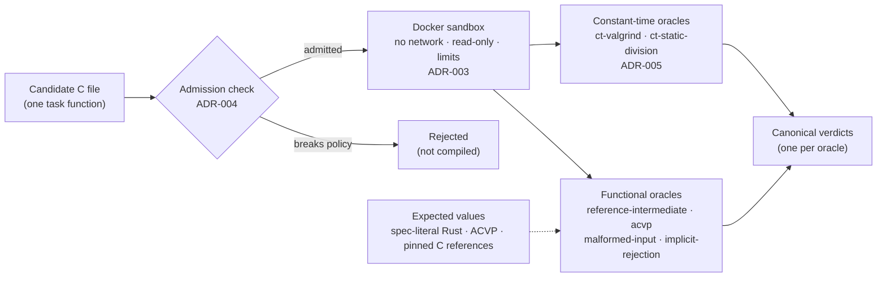

# oracle-trust-bench

[](https://github.com/raitaskeen/oracle-trust-bench/actions/workflows/ci.yml)
&nbsp;Code: MIT · Specs and data: CC BY 4.0 · Rust 1.100.0

The verification side of the research study **"The Oracle-Trust Gap:
Verifying LLM-Assisted Modernization of Cryptographic Code"**
(Taskeen Haider, ORCID [0009-0009-2783-4092](https://orcid.org/0009-0009-2783-4092)).

> **No model has been run; no results yet.**
> This repository holds the task specifications, the independent checks
> ("oracles"), the sandbox and the protocol. It makes no model calls and
> holds no API keys. The pre-registration is a draft
> ([`protocol/PREREGISTRATION.md`](protocol/PREREGISTRATION.md)).

---

## The question

When language models write post-quantum cryptographic code in C **and also
write its tests**, do passing tests justify trust?

The study measures how often an ML-KEM (FIPS 203) or ML-DSA (FIPS 204)
component passes its own model-written tests but fails an independent,
non-LLM check that applies to it. Its main hypothesis, **H1 (false
assurance)**, is that this happens for more than 5% of implementations that
pass their own tests. The full design (three hypotheses, three arms, the
statistics) is in [`protocol/APPLICATION.md`](protocol/APPLICATION.md).

Answering that needs checks that do not depend on any model's judgement.
This repository builds them, tests them against the standards, and proves
on hand-written faulty code that they catch what they claim to catch.

## How a test suite is judged

A model-written suite is one C file using `OTB_ASSERT`
([`c/harness/test-abi/otb_test.h`](c/harness/test-abi/otb_test.h)). It
counts only if it passes on the task's verified reference, executes at
least 5 assertions and kills at least one mutant of the reference
(121 mutants generated by fixed operators, 103 of them killable;
[ADR-006](docs/adr/ADR-006-test-suites-and-mutants.md)). An
implementation that passes its own valid suite but fails an applicable
oracle is a case of **false assurance**.

## How a candidate is judged



Expected values never enter the sandbox: the candidate only ever sees
inputs, and its outputs are compared in Rust. References, seeded faults and
candidates all go through the same code path.

## The oracles

| Oracle | What it checks | Applies to |
|---|---|---|
| `reference-intermediate` | Outputs equal FIPS 203/204, computed three ways that must agree: spec-literal Rust, mlkem-native/mldsa-native, and (where it applies) ACVP. Exhaustive where the input domain allows (8,380,417 inputs for Power2Round) | component tasks |
| `acvp` | Every applicable case of the NIST ACVP vector sets, counted by test group | top-level ML-KEM decapsulation |
| `malformed-input` | Wrong lengths must be refused (FIPS 203 section 7.3), the key hash check must run on every call, valid inputs must be accepted | ML-KEM decapsulation |
| `implicit-rejection` | A modified ciphertext must return 0 and K = J(z ‖ c), computed independently | ML-KEM decapsulation |
| `ct-valgrind` | No branch or memory address depends on a secret (Valgrind memcheck, -O2 and -O3) | every pilot task |
| `ct-static-division` | No division reachable from the task function in the emitted machine code for x86-64, AArch64, Cortex-M4 and Cortex-M0+ at -O2 and -O3 (the KyberSlash class) | every pilot task |
| `ct-dudect` | Statistical timing test on a pre-registered subsample | not yet implemented (nightly only) |
| `differential` | Differential fuzzing for C-to-Rust migration (Arm 3) | not in the pilot |

Which oracle applies to which task is fixed by the task specs, never at run
time: [`protocol/ORACLE_MATRIX.md`](protocol/ORACLE_MATRIX.md) (generated by
`otb matrix`).

## Pilot tasks

| Task | FIPS function | Interface |
|---|---|---|
| [MLKEM-T01-ntt](tasks/mlkem/T01-ntt/spec.md) | FIPS 203 Algorithm 9 (NTT) | `void ntt(int16_t f[256]);` |
| [MLKEM-T07-compress-d](tasks/mlkem/T07-compress-d/spec.md) | FIPS 203 Eq. 4.7 (Compress_d) | `uint16_t compress_d(uint16_t x, unsigned d);` |
| [MLKEM-T24-decaps-implicit-rejection](tasks/mlkem/T24-decaps-implicit-rejection/spec.md) | FIPS 203 Algorithms 18 and 21 | `int mlkem768_decaps(...)` |
| [MLDSA-T41-power2round](tasks/mldsa/T41-power2round/spec.md) | FIPS 204 Algorithm 35 | `void power2round(int32_t r, int32_t *r1, int32_t *r0);` |
| [MLDSA-T47-make-hint](tasks/mldsa/T47-make-hint/spec.md) | FIPS 204 Algorithm 39 | `int make_hint(int32_t z, int32_t r, int32_t gamma2);` |

The citations in every spec were checked against the FIPS documents; four
corrections are recorded in
[`docs/notes/fips-verification.md`](docs/notes/fips-verification.md).

## Proof that the oracles work

Eight hand-written faulty implementations
([`c/seeded-faults/`](c/seeded-faults/README.md); **synthetic examples
written by hand, not model outputs**) each document, in their header, what
every applicable oracle must conclude. `otb selftest` runs them all:

| Fault | Task | reference-intermediate | acvp | malformed-input | implicit-rejection | ct-valgrind | ct-static-division |
|---|---|:-:|:-:|:-:|:-:|:-:|:-:|
| 1 division by q (KyberSlash) | T07 | ✓ pass | – | – | – | ✓ pass ¹ | **✗ fail** |
| 2 error on rejection | T24 | – | **✗ fail** | **✗ fail** | **✗ fail** | **✗ fail** | ✓ pass |
| 3 no key hash check | T24 | – | **✗ fail** ² | **✗ fail** ² | ✓ pass | ✓ pass | ✓ pass |
| 4 one wrong zeta | T01 | **✗ fail** | – | – | – | ✓ pass | **✗ fail** |
| 5 off-by-one rounding (5 of 16,645 inputs) | T07 | **✗ fail** | – | – | – | ✓ pass | **✗ fail** |
| 6 sign error | T41 | **✗ fail** | – | – | – | ✓ pass | ✓ pass |
| 7 flipped comparison (98 of 1,000,340 inputs) | T47 | **✗ fail** | – | – | – | **✗ fail** | **✗ fail** ³ |
| 8 16-bit overflow (7,842 of 16,645 inputs) | T07 | **✗ fail** | – | – | – | ✓ pass | **✗ fail** |

Every one of the 29 documented outcomes holds. ¹ An asserted blind spot:
Valgrind cannot see division (GAP-CT-001). ² Reported as a task-contract
failure, not a FIPS violation (GAP-SPEC-001). ³ The source has no division;
the compiler created one from a loop, on Cortex-M0+
([measurement 4](docs/notes/ct-measurements.md)).

<details>
<summary>Raw output of <code>otb selftest</code> (Docker backend, 24 Nov 2026, 48 s)</summary>

```text
fault task                                 oracle                   expected                       observed
    1 MLKEM-T07-compress-d                 reference-intermediate   pass                           pass (16645 cases) [ok]
    1 MLKEM-T07-compress-d                 ct-valgrind              pass                           pass (2 cases) [ok]
    1 MLKEM-T07-compress-d                 ct-static-division       fail (variable-time-instruction) fail (variable-time-instruction; 2/10 cases; first: clang-armv6m-cortex-m0plus O2: bl __aeabi_uidiv in compress_d) [ok]
    2 MLKEM-T24-decaps-implicit-rejection  acvp                     fail (wrong-return-code)       fail (wrong-return-code; 10/20 cases; first: decapsulation tcId 88) [ok]
    2 MLKEM-T24-decaps-implicit-rejection  malformed-input          fail (wrong-return-code)       fail (wrong-return-code; 2/44 cases; first: key 0: bit flipped in dk_PKE) [ok]
    2 MLKEM-T24-decaps-implicit-rejection  implicit-rejection       fail (wrong-return-code)       fail (wrong-return-code; 32/36 cases; first: key 0: bit 0 of byte 0) [ok]
    2 MLKEM-T24-decaps-implicit-rejection  ct-valgrind              fail (secret-dependent-branch) fail (secret-dependent-branch; 2/2 cases; first: gcc-x86_64 -O2: Conditional jump or move depends on uninitialised value(s) at mlkem768_decaps (impl.c:55)) [ok]
    2 MLKEM-T24-decaps-implicit-rejection  ct-static-division       pass                           pass (10 cases) [ok]
    3 MLKEM-T24-decaps-implicit-rejection  acvp                     fail (task-contract)           fail (task-contract; 5/20 cases; first: decapsulationKeyCheck tcId 128) [ok]
    3 MLKEM-T24-decaps-implicit-rejection  malformed-input          fail (task-contract)           fail (task-contract; 8/44 cases; first: key 0: bit flipped in H(ek) first byte) [ok]
    3 MLKEM-T24-decaps-implicit-rejection  implicit-rejection       pass                           pass (36 cases) [ok]
    3 MLKEM-T24-decaps-implicit-rejection  ct-valgrind              pass                           pass (2 cases) [ok]
    3 MLKEM-T24-decaps-implicit-rejection  ct-static-division       pass                           pass (10 cases) [ok]
    4 MLKEM-T01-ntt                        reference-intermediate   fail (wrong-output)            fail (wrong-output; 1129/1258 cases; first: input 4) [ok]
    4 MLKEM-T01-ntt                        ct-valgrind              pass                           pass (2 cases) [ok]
    4 MLKEM-T01-ntt                        ct-static-division       fail (variable-time-instruction) fail (variable-time-instruction; 8/10 cases; first: clang-x86_64 O2: divl in ntt) [ok]
    5 MLKEM-T07-compress-d                 reference-intermediate   fail (wrong-output)            fail (wrong-output; 5/16645 cases; first: d=1 x=832) [ok]
    5 MLKEM-T07-compress-d                 ct-valgrind              pass                           pass (2 cases) [ok]
    5 MLKEM-T07-compress-d                 ct-static-division       fail (variable-time-instruction) fail (variable-time-instruction; 2/10 cases; first: clang-armv6m-cortex-m0plus O2: bl __aeabi_uidiv in compress_d) [ok]
    6 MLDSA-T41-power2round                reference-intermediate   fail (wrong-output)            fail (wrong-output; 4189185/8380417 cases; first: r=4097) [ok]
    6 MLDSA-T41-power2round                ct-valgrind              pass                           pass (2 cases) [ok]
    6 MLDSA-T41-power2round                ct-static-division       pass                           pass (10 cases) [ok]
    7 MLDSA-T47-make-hint                  reference-intermediate   fail (wrong-output)            fail (wrong-output; 98/1000340 cases; first: z=1 r=261887) [ok]
    7 MLDSA-T47-make-hint                  ct-valgrind              fail (secret-dependent-branch) fail (secret-dependent-branch; 2/2 cases; first: gcc-x86_64 -O2: Conditional jump or move depends on uninitialised value(s) at high_bits (impl.c:44)) [ok]
    7 MLDSA-T47-make-hint                  ct-static-division       fail (variable-time-instruction) fail (variable-time-instruction; 2/10 cases; first: clang-armv6m-cortex-m0plus O2: bl __aeabi_uidivmod in make_hint) [ok]
    8 MLKEM-T07-compress-d                 reference-intermediate   fail (wrong-output)            fail (wrong-output; 7842/16645 cases; first: d=5 x=2048) [ok]
    8 MLKEM-T07-compress-d                 ct-valgrind              pass                           pass (2 cases) [ok]
    8 MLKEM-T07-compress-d                 ct-static-division       fail (variable-time-instruction) fail (variable-time-instruction; 2/10 cases; first: clang-armv6m-cortex-m0plus O2: bl __aeabi_uidiv in compress_d) [ok]
    8 MLKEM-T07-compress-d                 test suite               valid, passes on the fault     valid (passes (7 assertions); 11/13 mutants killed); on the fault it passes (7 assertions) [ok]
29 expectations hold, 0 do not, 0 pending
```

</details>

### False assurance in miniature

Fault 8 comes with a weak test suite written by hand in the style of a
quick model-written one: 7 assertions, d = 1 and d = 4 only
([`suites/f08-tests.c`](c/seeded-faults/suites/f08-tests.c)). By the
study's rules the suite **counts**: it passes on the verified reference,
has at least 5 assertions and kills 11 of 13 mutants. It **passes on
fault 8**. The independent oracle **fails** fault 8 on 7,842 of 16,645
inputs. That gap, measured over thousands of model-written
implementations, is what H1 is about.

And the other direction: on the unmodified references, `otb ref run`
passes all 18 oracle runs, so every oracle has 0 false positives on the
five references
([`docs/oracles/false-positives.md`](docs/oracles/false-positives.md)).

## Quick start

Requirements: Linux (or WSL2), [rustup](https://rustup.rs) (the pinned
toolchain in `rust-toolchain.toml` installs itself), Docker, and
`cargo install cargo-nextest`.

```sh
git clone --recurse-submodules https://github.com/raitaskeen/oracle-trust-bench.git
cd oracle-trust-bench

cargo nextest run --workspace --locked             # unit, property and vector tests
cargo run -q -p otb-cli -- tasks validate          # check the five task specs
cargo run -q -p otb-cli -- matrix                  # task-by-oracle matrix

docker build -t otb-candidate:dev docker/          # pinned compilers and Valgrind
export OTB_SANDBOX_IMAGE=$(docker image inspect otb-candidate:dev --format '{{.Id}}')

cargo run -q --release -p otb-cli -- ref run       # every oracle on the references
cargo run -q --release -p otb-cli -- selftest      # every seeded fault, as documented
cargo run -q --release -p otb-cli -- check \
    --task MLKEM-T07-compress-d --candidate my_compress.c   # judge one C file
cargo run -q --release -p otb-cli -- suite \
    --task MLKEM-T07-compress-d --tests my_tests.c \
    --candidate my_compress.c                            # judge a test suite
```

If you cloned without `--recurse-submodules`, `third_party/mlkem-native`
and `third_party/mldsa-native` are empty; fetch them with
`git submodule update --init` before building.

`otb check` prints one line per oracle; `--json` prints canonical verdict
records instead. Candidate code runs only under Docker. A weaker fallback
backend (`--backend unshare`, no filesystem isolation, GAP-SBX-001) exists
for developing the harness itself.

## Status

| Milestone | Status |
|---|---|
| M0-M3: environment, core types, task specs, vectors, sandbox, C references | done |
| M4: malformed-input and implicit-rejection oracles, admission check, faults 2-7 | done |
| M5a: constant-time oracles, fault 1, false-positive table | done |
| M5b: runner for model-written test suites, mutants, fault 8 | done |
| M6: run records, determinism at 1/4/16 jobs, statistics, power analysis | next |
| M7: full pre-registration, threat model, documentation site | planned |
| M8: independent review | planned |

The tracker with evidence for each step is [`docs/PLAN.md`](docs/PLAN.md).

## Reproducibility

- Rust toolchain pinned (`rust-toolchain.toml`), dependencies locked
  (`Cargo.lock`), licences and advisories checked (`cargo deny`,
  `cargo audit`).
- C compilers and Valgrind fixed in [`docker/Dockerfile`](docker/Dockerfile):
  Debian 13.8 base pinned by digest, GCC 14.2.0, Clang 19.1.7 and
  Valgrind 3.24.0 pinned to exact package versions.
- Reference libraries pinned by commit as submodules: mlkem-native v2.0.0
  and mldsa-native v2.0.0. ACVP vectors vendored with SHA-256 sums
  ([`NOTICE.md`](NOTICE.md)).
- CI actions pinned by commit; the test suite runs with the network
  removed; the sandbox job runs `otb ref run` and `otb selftest`.
- Every number in the documentation names the command that produced it.

## Known limits

Every known limit has a stable ID in [`KNOWN_GAPS.md`](KNOWN_GAPS.md), and
code cites them by ID. The most important today: Valgrind cannot see
division (GAP-CT-001); the division check does not trace whether operands
are secret (GAP-CT-002); the ACVP files are small example sets
(GAP-ACVP-002); the reference values are trusted by agreement, not proof
(GAP-REF-001); the admission check is lexical (GAP-ADM-001); mutants
are first-order and their equivalence is decided by the oracles
(GAP-MUT-001).

## Glossary

| Term | Meaning here |
|---|---|
| ML-KEM (FIPS 203) | NIST's post-quantum key-encapsulation standard, derived from CRYSTALS-Kyber |
| ML-DSA (FIPS 204) | NIST's post-quantum digital-signature standard, derived from CRYSTALS-Dilithium |
| ACVP | NIST's Automated Cryptographic Validation Protocol; its published vector sets give inputs with known correct outputs |
| Oracle | An independent, non-LLM check that decides whether a candidate is correct for one property |
| Reference | A verified implementation of a task: spec-literal Rust plus mlkem-native/mldsa-native, trusted only where they agree (GAP-REF-001) |
| Candidate | A C file implementing one task function, judged by the oracles |
| Admission check | The policy check a candidate must pass before it is compiled ([ADR-004](docs/adr/ADR-004-implementations-and-admission.md)) |
| Seeded fault | A hand-written faulty implementation that proves an oracle catches what it claims |
| Mutant | A small, automatically generated change to a reference, used to judge whether a test suite is strong enough |
| False assurance | A candidate passes its own valid test suite but fails an applicable oracle |
| Constant time | Branches and memory addresses do not depend on secret data, and no variable-time instruction such as division touches it |
| KyberSlash | A class of timing leaks caused by secret-dependent division in Kyber/ML-KEM code |
| Implicit rejection | On a modified ciphertext, ML-KEM decapsulation returns the key J(z ‖ c) instead of an error, so an attacker learns nothing |
| Pre-registration | Fixing the hypotheses and analysis plan before any data is collected |

## Repository layout

| Path | Contents |
|---|---|
| `tasks/` | Task specs: TOML front matter (FIPS references, C interface, secrets, oracles) plus notes |
| `crates/otb-core` | IDs, oracle kinds, verdicts, canonical JSON, spec loading |
| `crates/otb-vectors` | Strict ACVP parsers |
| `crates/otb-oracles` | Spec-literal FIPS 203/204 implementations in Rust |
| `crates/otb-sandbox` | Docker and fallback sandboxes |
| `crates/otb-harness` | Admission, oracles, constant-time checks, mutants, suite runner, selftest |
| `crates/otb-cli` | The `otb` command |
| `c/harness/` | Task drivers and reference adapters |
| `c/seeded-faults/` | Hand-written faulty implementations and their test suites |
| `c/mutation-base/` | Verified references the mutants come from, and the committed mutant manifests |
| `c/harness/test-abi/` | The interface model-written test suites use |
| `docker/` | The pinned compiler image |
| `third_party/` | mlkem-native, mldsa-native (submodules) and ACVP vectors |
| `protocol/` | Application text, oracle matrix, draft pre-registration |
| `docs/` | Plan, testing strategy, ADRs, measurements, notes |

## Design decisions

[ADR-001](docs/adr/ADR-001-rust-harness-with-c-shims.md) Rust harness with
C shims ·
[ADR-002](docs/adr/ADR-002-canonical-json-and-stable-ids.md) canonical JSON
and stable IDs ·
[ADR-003](docs/adr/ADR-003-sandbox-design.md) sandbox ·
[ADR-004](docs/adr/ADR-004-implementations-and-admission.md) one code path
and candidate admission ·
[ADR-005](docs/adr/ADR-005-constant-time-method.md) constant-time method ·
[ADR-006](docs/adr/ADR-006-test-suites-and-mutants.md) test suites and
mutants

## Contributing, AI assistance and licences

- How changes are proposed and reviewed: [`CONTRIBUTING.md`](CONTRIBUTING.md);
  testing rules: [`docs/TESTING.md`](docs/TESTING.md); rules for AI agents:
  [`AGENTS.md`](AGENTS.md).
- The code and documents were drafted with AI assistance (Claude, through
  Claude Code) and reviewed by the author; the models the study evaluates
  were not used to write this repository
  ([`AI_ASSISTANCE.md`](AI_ASSISTANCE.md)).
- Code: MIT ([`LICENSE`](LICENSE)). Task specs and data: CC BY 4.0
  ([`LICENSE-DATA`](LICENSE-DATA)). Third-party components keep their own
  licences ([`NOTICE.md`](NOTICE.md)).

## Citation

Until the study is published, please cite the repository:

> Taskeen Haider. *oracle-trust-bench: the verification side of "The
> Oracle-Trust Gap: Verifying LLM-Assisted Modernization of Cryptographic
> Code".* 2026. https://github.com/raitaskeen/oracle-trust-bench
